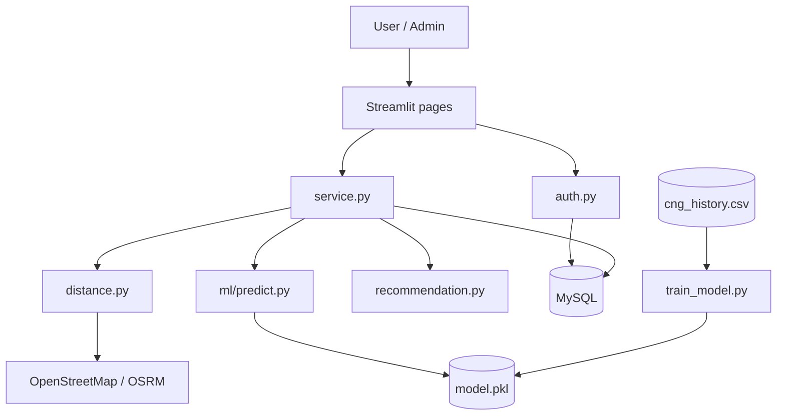
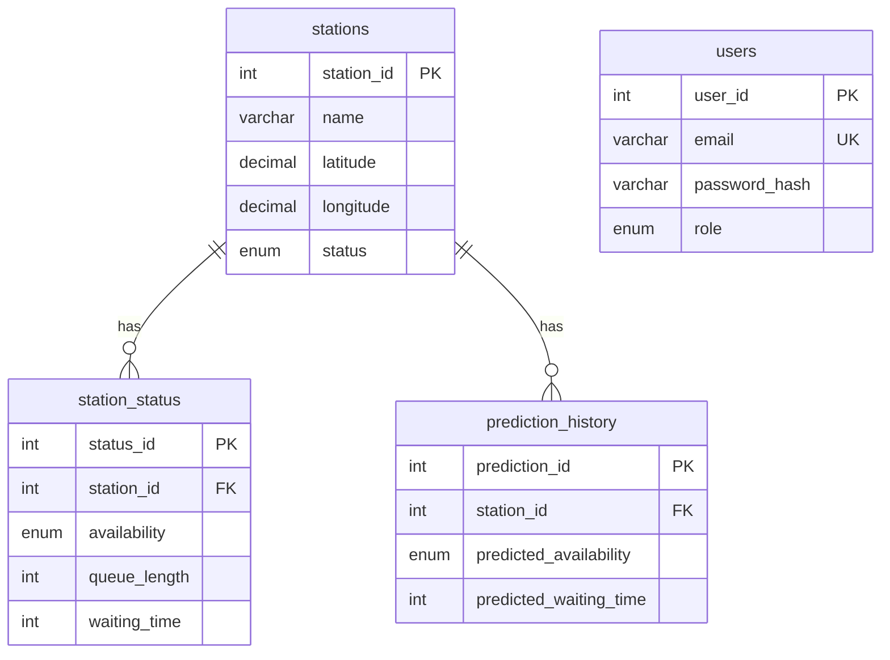
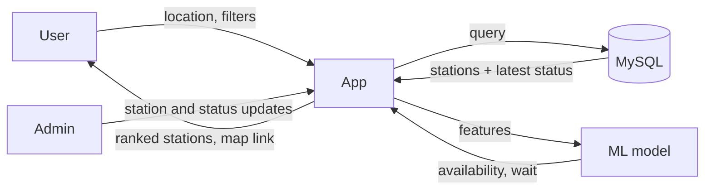
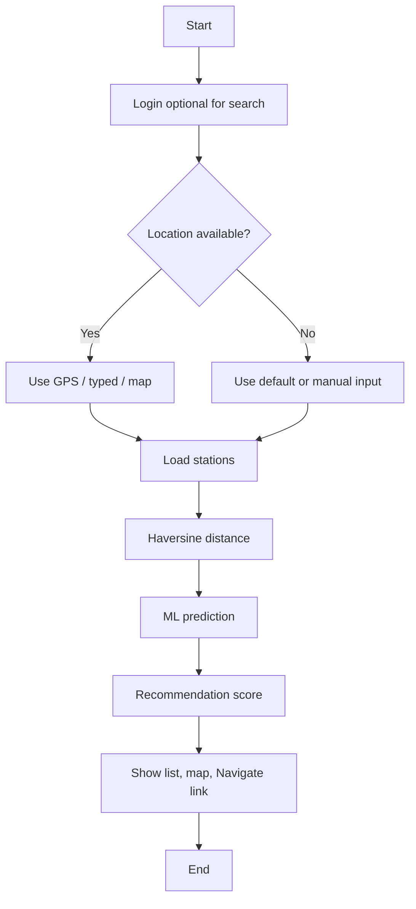
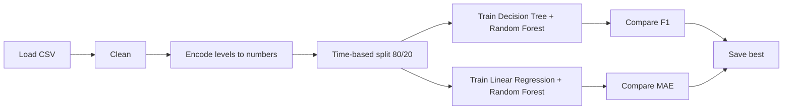

# Smart CNG Availability Prediction and Navigation System Using Artificial Intelligence

## 1. Title
Smart CNG Availability Prediction and Navigation System Using Artificial Intelligence

## 2. Abstract
CNG users often waste time searching for a station and standing in queues. This project is a web application that lists nearby CNG stations, calculates distance with the Haversine formula, predicts availability (High/Medium/Low) and waiting time with machine learning, ranks stations with a transparent score, and opens navigation links. Predictions are estimates from historical data, labelled "AI Predicted Availability"; no real-time sensor is connected. The prototype uses synthetic sample data and is designed so real-time data can be added later.

## 3. Introduction
CNG adoption is growing, but stations are limited and demand peaks at certain hours. Information about queues is usually unavailable.

## 4. Problem Statement
Drivers cannot easily know which station is nearby, likely to have fuel, and has a short wait.

## 5. Existing System
Map apps show station locations only. Drivers rely on phone calls or word of mouth. There is no waiting-time prediction or ranking by expected wait.

## 6. Proposed System
A Streamlit web app combining location, station data, ML prediction and a weighted recommendation score, with an admin panel for data management.

## 7. Objectives
Find nearby stations; show details; estimate queue and waiting time; compute distance; recommend stations; predict availability with ML; give navigation; support manual location; provide admin management.

## 8. Need and Importance
Saves time and fuel, reduces congestion at stations, and gives a base for smart-city fuel services.

## 9. Scope
Single-city prototype, web-based, sample data. Out of scope: payments, live IoT sensors, native mobile app.

## 10. System Requirements
### 11. Hardware
Any PC with 4 GB RAM (8 GB recommended), dual-core CPU, internet for map services.
### 12. Software
Windows 10/11, Python 3.10+, MySQL 8, VS Code, Git, modern browser.

## 13. Technology Stack
Streamlit (UI), Python (logic), MySQL (data), pandas/NumPy/scikit-learn (ML), Plotly (charts), Folium + OpenStreetMap, Nominatim, OSRM, bcrypt.

## 14. System Architecture

## 15. Modules
Account (register/login/profile) · Location (manual, coordinates, browser GPS) · Station search · AI prediction · Recommendation · Navigation · Admin dashboard · Analytics.

## 16. Database Design
Tables: `users`, `stations`, `station_status`, `prediction_history` (see `database/schema.sql`). Foreign keys with ON DELETE CASCADE; CHECK constraints on coordinates.

## 17. ER Diagram

`users` is independent; its role column controls admin access.

## 18. Data Flow Diagram

## 19. Flowchart

## 20. Machine Learning Methodology

Features: station, hour, day, weekend flag, queue, traffic, vehicles/hour, previous wait, previous availability.
Targets: availability (classification) and waiting time (regression). Data is synthetic, so scores show that the pipeline works, not real-world accuracy.

## 21. Algorithms
- **Haversine**: `d = 2R asin(sqrt(sin²(Δφ/2) + cosφ1 cosφ2 sin²(Δλ/2)))`, R = 6371 km.
- **Random Forest**: many decision trees trained on random subsets, majority vote/average.
- **Recommendation**: `score = 100 x Σ(weight_i x factor_i) / Σ weights` with factors scaled 0-1.

## 22. Implementation
Python modules under `utils/`, `ml/`, `pages/`; MySQL through parameterized queries; bcrypt hashing; Folium map; Plotly charts. See README for run steps.

## 23. Testing
See the test table in README (15 cases). Unit tests in `tests/test_core.py` (`pytest -v`).

## 24. Results
Development run on synthetic data (2880 rows, latest 20% by date as test set):

| Task | Model | Result |
|---|---|---|
| Availability | Decision Tree | accuracy 0.649, F1 0.649 |
| Availability | Random Forest (selected) | accuracy 0.693, F1 0.687 |
| Waiting time | Linear Regression (selected) | MAE 2.68 min, RMSE 3.65, R² 0.92 |
| Waiting time | Random Forest | MAE 2.83 min, RMSE 3.86, R² 0.91 |

The high R² partly reflects that synthetic waiting time was generated from queue length; real data will be noisier. Re-run training to reproduce (numbers may differ if the dataset is regenerated on another day).

## 25. Advantages
Low cost, explainable ranking, works without GPS, secure passwords, extendable to real-time sources.

## 26. Limitations
Synthetic data; predictions are not live availability; public map servers have usage limits; single city.

## 27. Future Scope
IoT sensors or fuel-company APIs, retraining on real logs, mobile app, station booking, multi-city support, notifications.

## 28. Conclusion
The prototype shows how location data, ML prediction and transparent ranking can reduce time spent finding CNG, and it is ready to receive real data.

## 29. References
1. Streamlit documentation, https://docs.streamlit.io
2. scikit-learn documentation, https://scikit-learn.org
3. OpenStreetMap, Nominatim and OSRM project documentation
4. MySQL 8.0 Reference Manual
5. Sinnott, R. W., "Virtues of the Haversine", Sky and Telescope, 1984
6. Breiman, L., "Random Forests", Machine Learning, 2001
